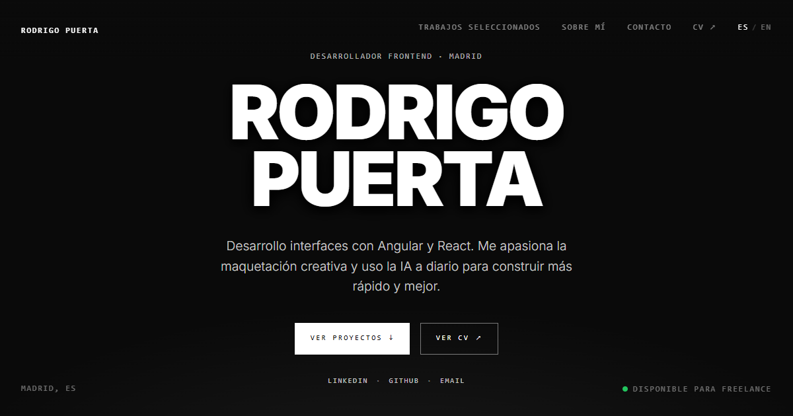

# Rodrigo Puerta · Portfolio

Portfolio personal de **Rodrigo Puerta del Pozo**, desarrollador Frontend en Madrid.

**🌐 Web:** [rpuertadelpozo.com](https://rpuertadelpozo.com)



Una web de una sola página con estética oscura y cinematográfica: tipografía gigante en mayúsculas, etiquetas en monoespaciada, fotos en blanco y negro y cada proyecto a pantalla completa.

---

## Qué hay en la web

| Sección | Contenido |
| --- | --- |
| **Presentación** | Nombre, rol en una línea y botón para ir a los proyectos. |
| **Proyectos** | Un proyecto por pantalla con foto de fondo, stack, tipo, estado y año. Al pulsarlo se abre la **demo** (o el **repositorio** si no tiene demo). |
| **Sobre mí** | Bio, stack con iconos, experiencia y formación. Fondo con un efecto líquido en WebGL que reacciona al ratón. |
| **Contacto** | Email, LinkedIn, GitHub y CV, siempre visibles. |

### Proyectos incluidos

| Proyecto | Qué es | Stack | Enlaces |
| --- | --- | --- | --- |
| **Fundamental** | Web y catálogo de componentes de bicicleta | Astro · Supabase · Tailwind | [Demo](https://fundamental-gold.vercel.app) · [Repo](https://github.com/DevRodrigoPdp/Fundamental) |
| **Synapses** | E-commerce de ciclismo, primer proyecto con React (DAW) | React | [Demo](https://synapses-eta.vercel.app) · [Repo](https://github.com/DevRodrigoPdp/Synapses) |
| **CourtVision** | App Android para entrenadores de baloncesto, TFG de DAM | Kotlin · Firebase | [Repo](https://github.com/DevRodrigoPdp/courtvision-degree) |
| **GRIT** | Plataforma entre entrenadores y atletas, TFG de DAW | Angular · Tailwind | [Demo](https://frontend-rho-two-49.vercel.app) · [Repo](https://github.com/DevRodrigoPdp/GRIT) |

### Detalles

- **CV con vista previa:** en escritorio se abre en un panel lateral animado (descargar, abrir en pestaña nueva o cerrar); en móvil se abre el visor nativo del PDF.
- **Bilingüe:** español e inglés, con un selector ES / EN.
- **Cursor personalizado** en escritorio (no aparece en táctil).
- **Accesible:** foco visible con teclado, contraste WCAG AA en el texto sobre fotos y respeto a `prefers-reduced-motion`.
- **Ligero:** imágenes en WebP y Three.js cargado en diferido, solo en escritorio y cuando la sección "Sobre mí" se acerca.

---

## Con qué está hecho

| Tecnología | Para qué |
| --- | --- |
| [React 19](https://react.dev) | Interfaz |
| [Vite](https://vite.dev) | Servidor de desarrollo y build |
| [Tailwind CSS 4](https://tailwindcss.com) + CSS propio | Estilos |
| [Framer Motion](https://motion.dev) | Animaciones de entrada, menú móvil y panel del CV |
| [Three.js](https://threejs.org) + [React Three Fiber](https://r3f.docs.pmnd.rs) | Efecto líquido (shader) de "Sobre mí" |
| [React Icons](https://react-icons.github.io/react-icons/) | Iconos del stack |
| [React Router](https://reactrouter.com) | Redirige rutas antiguas a la home |
| [Vercel](https://vercel.com) | Hosting y despliegue |

Fuente: **Inter** (Google Fonts) y una monoespaciada del sistema para las etiquetas.

---

## Estructura

```
src/
├── App.jsx                 Página principal y secciones
├── components/
│   ├── IntroHero.jsx       Presentación
│   ├── ProjectViews.jsx    Proyectos a pantalla completa
│   ├── AboutPage.jsx       Sobre mí (carga LiquidBlob en diferido)
│   ├── LiquidBlob.jsx      Efecto WebGL con Three.js
│   ├── CinematicFooter.jsx Contacto
│   ├── CvPreview.jsx       Enlace "Ver CV" y panel de vista previa
│   ├── GlobalNav.jsx       Menú de escritorio y móvil
│   ├── Cursor.jsx          Cursor personalizado
│   ├── PageIndicator.jsx   Puntos de navegación lateral
│   └── ScrollIndicator.jsx Indicador de scroll
├── context/
│   └── LanguageContext.jsx Textos en español e inglés
├── data/
│   ├── data.js             Proyectos
│   └── contact.js          Email, GitHub y LinkedIn
├── hooks/                  useActiveSection, useCursor
├── images/projects/        Fotos de portada (WebP)
└── index.css               Estilos globales
public/
├── cv-rodrigo-puerta.pdf   CV
└── og-image.png            Imagen para redes sociales
```

---

## Desarrollo

Necesita Node.js 20 o superior.

```bash
npm install
npm run dev       # servidor local en http://localhost:5173
npm run build     # build de producción en dist/
npm run preview   # previsualizar el build
npm run lint      # ESLint
```

### Añadir o editar un proyecto

Todo está en [`src/data/data.js`](src/data/data.js). Cada proyecto es un objeto:

```js
{
  slug: "mi-proyecto",
  title: "Mi Proyecto",
  stackLabel: "React & Node",
  typeKey: "plataformaWeb",   // clave de traducción en LanguageContext.jsx
  statusKey: "enDesarrollo",  // clave de traducción en LanguageContext.jsx
  year: "2026",
  cover: miProyectoCover,     // import de src/images/projects/<slug>/cover.webp
  demo: "https://...",        // opcional: si no hay, se enlaza el repo
  repo: "https://github.com/...",
}
```

Con `draft: true` el proyecto no se muestra.

### Cambiar textos o el CV

- Textos de la web: `src/context/LanguageContext.jsx` (español e inglés).
- Datos de contacto: `src/data/contact.js`.
- CV: sustituir `public/cv-rodrigo-puerta.pdf` manteniendo el nombre.

---

## Despliegue

Desplegado en **Vercel** con el dominio propio `rpuertadelpozo.com`. El archivo `vercel.json` manda todas las rutas a `index.html`, así que una URL antigua como `/projects/...` vuelve a la home en lugar de dar 404.
